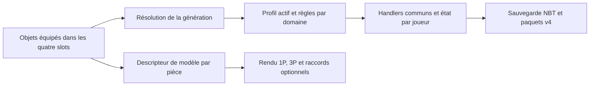

# Moteur multi-Nanosuit sur NeoForge 1.21.1

## Référence et périmètre

La branche `refactor/multi-nanosuit` part de `545d51df4d0425761110fe956ccf1e743d0adbf5` sur `consolidation/nanosuit-legacy-current`. L’arbre était propre au départ. Le JAR de référence a été figé sous `build/multi-suit-reference/baseline.jar`, SHA-256 `D6B484303245567491F370DD34EC78C24A0ADA15379149B6ED1252A835A42BB8`. Le rapport de consolidation décrit les essais précédents et les problèmes OpenGL préexistants.

## Architecture retenue

- **Identité.** Trois identités logiques peuvent être reconnues. Seuls les quatre objets historiques s’inscrivent au registre et résolvent un profil actif. La résolution examine chaque emplacement et exige une identité homogène pour les pouvoirs de set. La présentation peut toujours être résolue pièce par pièce. Un casque reconnu garde son rôle séparé pour la Nanovision.
- **Règles.** Le profil compose des règles immuables par domaine. La sélection des modes et les pouvoirs contextuels sont distincts de leurs paramètres d’énergie, de mobilité, de combat et de visière. Les identités futures n’ont aucune valeur de gameplay active. Les réglages serveur existants continuent d’être lus en direct.
- **Exécution.** Les handlers partagés restent propriétaires de la charge, des dépenses, des dégâts, des collisions, du ciblage et des effets. Une même réserve d’énergie et des échéances par joueur sont réutilisées lorsqu’une pièce est retirée ou remise. Le réseau v4 transmet toujours des intentions et des résultats historiques. Le client ne fournit ni le profil ni le coût au serveur.
- **Présentation.** Les ressources d’armure par génération sont séparées des règles et utilisent les moteurs NanoGeo, Punchy, TaCZ, EMF et Iris existants. Le futur modèle devra fournir des os et textures compatibles avec les chemins 1P et 3P.
- **Activation future.** Une identité ne suffit pas à activer un profil. Une fiche complète des règles et l’association des objets devront précéder l’activation. Pour le mode Strength/Speed de la Nanosuit 1, il faudra représenter et transporter de nouveaux états avec des identifiants stables. Les capacités contextuelles de la Nanosuit 2 restent séparées des modes manuels. Les modules d’amélioration seront des extensions propres à ce futur profil.

## Matrice de traçabilité de l’existant

Les tables décrivent le comportement de départ, y compris les cas atypiques à préserver. Une suggestion de test dans une table d’audit ne constitue pas un résultat d’exécution.

### Équipement, durée de vie et contrats réseau

Les emplacements indiqués dans les matrices sont relatifs à `src/main/java/io/github/painworks/crysismod/`, sauf mention d’une ressource ou d’une configuration. Les résultats de tests sont attribués dans la section de validation. Les scénarios listés ici sont les vérifications de traçabilité.

| Règle | Emplacement | Déclencheur et garde | Paramètres et interaction | Dépendance | Vérification et incertitude |
| --- | --- | --- | --- | --- | --- |
| Identité d’une pièce | `registry/ModItems`, `nanosuit/util/NanosuitArmorUtil`, `ExperimentalNanoGeoArmorItem` | Détection par égalité avec les quatre objets NeoForge attendus à leurs emplacements. | IDs `crysismod:nanogeo_nanosuit_helmet/chestplate/leggings/boots` (préfixe commun), matériau Netherite, durabilité vanilla au facteur 37. Les alias « expérimental » et « production » reconnaissent les mêmes objets. Les deux options de sélection de variante dans `NanosuitArmorIdentityConfig` ne déterminent pas le set effectif. | Registre NeoForge. | Tester quatre pièces, casque seul, pièce absente, Netherite à la place, mélange d’identités dans le résolveur pur. |
| Set complet et retrait | `NanosuitArmorUtil.evaluate`, `NanosuitPlayerHandler.tickPlayer`, `tickEnhancedJumpCharge`, `tickEnhancedJumpMantle` | Quatre pièces exactes dans quatre slots. Retrait évalué au tick et aux demandes serveur. | Set incomplet coupe mode, boost et effets au tick hors panne. Charge et guidage revalident le set. La Nanovision peut avoir sa propre exigence de casque. Ni réserve ni timers ne sont réinitialisés par un simple retrait. | Aucune. | Cloak avec retrait et retour visuel, retrait pendant charge, retour d’équipement à 19/20 ticks, maintien du verrou pendant l’échange. Les sets mixtes de deux générations ne sont pas actuellement équipables. |
| Spawn, mort, portail, déconnexion | `NanosuitPlayerHandler.onPlayerClone/onPlayerLoggedIn/onPlayerRespawn/onPlayerChangedDimension/onPlayerLoggedOut` | Événements NeoForge. | Clone, connexion, respawn et changement de dimension réinitialisent une partie des états runtime dont les cooldowns. Changement de dimension retire d’abord l’invisibilité du suit. Déconnexion efface le cache runtime, les traces de saut et le cache de synchronisation. Le boost prêt est explicitement effacé à la reprise, l’attachement énergie est copié à la mort. | NeoForge. | Rejouer mort/portail/reconnexion sous verrou et cloak. Reset des cooldowns à ces événements est un comportement historique distinct de l’échange de pièces. |
| Données et sauvegarde | `nanosuit/energy/NanosuitEnergy`, `INanosuitEnergy`, `NanosuitCapabilities` | Attachement `crysismod:nanosuit_energy`, lecture/écriture joueur. | NBT `Energy` float, `Mode` chaîne, `RegenDelayTicks` et `RecoveryTicks` int. Pas de boost ni de profil sauvegardé. Mode inconnu → NONE, énergie bornée 0–100, ancien NBT à 0 sans champ de panne → verrou. À 100 la panne est levée. | NeoForge attachment serializable, `copyOnDeath`. | Aller-retour NBT avec panne et sans champ historique. Test complet de migration de mondes anciens à distinguer. |
| Action serveur | `nanosuit/network/NanosuitNetwork`, `ToggleNanosuitModePacket`, `RequestSprintBoostPacket`, `RequestEnhancedJumpPacket`, `SetNanovisionActivePacket`, `SetNanoVisorActivePacket`, `RequestNanoVisorMarkTargetPacket` | Le joueur envoie une intention. Les handlers exigent un `ServerPlayer` et recalculent l’éligibilité. | Protocole 4, aucun profil, coût, énergie ni identité d’équipement n’est fourni par le client. Les enums v4 de mode et phase conservent leur ordinal. La charge est bornée et le marquage a ses propres filtres serveur. | NeoForge payloads, aucune API de mod tiers dans le format. | Demande de saut sans BEGIN, requêtes à 9 points et pendant panne, refus de mode sans équipement. |
| Réplique propriétaire | `NanosuitSyncManager`, `SyncNanosuitDataPacket`, `ClientNanosuitPacketHandlers`, `SyncEnhancedJumpPacket`, `SyncMantleMotionPacket`, `SyncPowerJumpDebugPacket`, `SyncSuitEnergySoundPacket`, `SyncPowerFeedbackPacket`, `SyncThreatLevelPacket`, `SyncNanoVisorMarkedTargetsPacket` | Actions réussies, ticks et événements de cycle de vie. | Énergie/mode/boost/verrou vers le joueur. Le client reconstruit l’attachement et déclenche le feedback de changement de mode. Impulsion et guidage ont leur propre retour. Menace, sons, marquage et flashs ont leurs paquets. | Réseau v4. | Confronter énergie client/serveur à 90 et 0, son et HUD, export codec bytecode avant/après. Serveur dédié à couvrir séparément. |
| Vue d’un autre joueur | `nanosuit/client/render/NanosuitCloakRender`, `NanosuitArmorModeOverlayState`, mixins de joueur et objets tenus | Render distant, équipement et métadonnées d’entité synchronisés. | Cloak distant déduit du set et du flag invisible hors effet de potion. L’overlay Armure lit aussi l’attachement client du joueur rendu. La synchronisation du mode vise le propriétaire, donc l’affichage Armure distant reste à vérifier. Les rendus ne commandent aucun pouvoir serveur. | Rendu Minecraft, raccords Punchy/TaCZ/Iris facultatifs. | Deux clients sur serveur intégré en loopback, vérifier visibilité et retour opaque. Limite future si mode Armor et absorption externe doivent devenir distincts. |
| Options, commandes et ressources auxiliaires | `CrysisMod`, `CrysisModClientBootstrap`, `nanosuit/command/NanosuitDebugCommands`, `PowerJumpDebugCommands`, `META-INF/neoforge.mods.toml` | Enregistrement des événements, réglages et commande avec permission. | Les commandes d’administration et les écrans de diagnostic exposent certaines valeurs. Java 21, NeoForge 21.1.265 en dev, Cloth Config côté client. Aucun nouveau point d’entrée gameplay pour les générations inactives. | Versions facultatives vérifiées dans les rapports locaux. | Build avec/sans mods optionnels dans profils isolés. Pas d’affirmation de compatibilité universelle. |

## Énergie, état persistant et mobilité

Les chemins ci-dessous sont relatifs à `src/main/java/io/github/painworks/crysismod/`. Les valeurs TOML sont des valeurs par défaut et restent surchargeables. Les références de validation sont les journaux historiques de l’atelier, en particulier `build/legacy-functional-qa/after-core/console.log`, `after-controls-instrumented/console.log` et `build/consolidation-jump-qa/after/console.log`. Une proposition d’essai indique une couverture non démontrée par ces journaux.

| Règle et effet | Emplacement | Déclencheur | Conditions | Paramètres historiques | Interactions et limites | Dépendance | Vérification |
| --- | --- | --- | --- | --- | --- | --- | --- |
| E1 — Énergie bornée, mise en panne | `nanosuit/energy/NanosuitEnergy.java` et `INanosuitEnergy.java` | Création d’une donnée, débits, crédit ou changement de mode | 0 coupe le mode et le sprint, verrou actif si compteur ≥ 0, 100 déverrouille | Réservoir initial et max 100, min 0, compteur initial -1 | Un débit sous zéro est borné, `setMode` et `setSprintBoostReady` restent bloqués pendant une recharge partielle | Attachement NeoForge | CORE `ZERO_LOCK`, `PARTIAL_CHARGE_LOCK`, `RESTORE_AT_100` et JUMP `RECOVERY_LOCK_WITH_ENERGY`. |
| E2 — Régénération et délai | `nanosuit/handler/NanosuitPlayerHandler.java`, `tickPlayer`, `getBaseDrainPerTick` et `nanosuit/config/NanosuitServerConfig.java` | Tick post serveur, sans drain actif après le délai | Set complet en NONE, sans boost ni panne. Sans set et sans Nanovision, recharge brute | `energy.regenPerTick` 1,2 par tick, délai `energy.regenDelayAfterDrainTicks` 30 ticks. Charge nette avec set à l’arrêt 1,15 et en mouvement 0,95 par défaut, car soustraction 0,05/0,25 | Les débits de saut, mêlée ou combat cloak relancent le délai. Un absorb Armor isolé débite directement, sans modifier ce délai dans son handler. Réglage custom drain supérieur à régénération peut rendre le crédit négatif | — | Vérifier la pente et le tick de reprise, même entrée et même TOML, set complet/incomplet. Ce détail n’est pas couvert par les tests de panne. |
| E3 — Priorité et débits combinés | `NanosuitPlayerHandler.tickPlayer`, `getModeDrainPerTick` | Tick post serveur | Set complet, énergie positive pour boost, conditions mode/boost | Armor arrêt/marche/boost 0,0625/0,083333336/0,25, Cloak 0,0625/0,25/0,5. Sans mode boost 0,75 par défaut | Le mode actif remplace le barème de base, le boost choisit la ligne rapide, Nanovision ajoute 0,083333336 par défaut à la branche débit. Les coûts physiques ponctuels sont distincts. Le réglage `energy.drainActiveModePerTick` 0,5 est conservé en TOML mais sans consommateur effectif | — | Mesurer ≥ 40 ticks par combinaison, dont mode + Nanovision + sprint ou nage. CORE couvre séparément les modes et le Power Swim. |
| E4 — Cas particulier Nanovision seule | `NanosuitPlayerHandler.tickPlayer`, `NanovisionServerState.isActive` | Tick post serveur avec Nanovision | Sans set, si réglage visière permet l’activation. Avec set et aucun mode ni boost, le calcul du débit n’est pas appliqué par la branche `DrainState.NONE` | Drain nominal 0,083333336 par tick, délai 30 par défaut | En set complet, Nanovision seule laisse suivre le chemin régénération/délai. Sans set, Nanovision active débite. Ce comportement historique asymétrique est à conserver | — | Tester sans set avec config permissive, puis avec set NONE, puis avec ARMOR. Mesurer sur serveur et client. |
| E5 — Mouvement servant au barème | `NanosuitPlayerHandler.isMoving` et `isMovingForCloak` | Tick post serveur avec set | Une des mesures dépasse son seuil, puis maintien court | Distance XZ² suivie ou vanilla > 0,000625, variation marche > 0,001, entrée X/Z > 0,01, vitesse XZ² > 0,0001, compteur 4 dont 3 ticks silencieux restent vrais | Sert aussi à la portée de détection cloak, compteur effacé à la panne, zéro et sans set. N’est pas le test de sprint | — | Contrôler à l’arrêt, un déplacement bref, puis mesurer la fenêtre de persistance. |
| E6 — Créatif | `NanosuitPlayerHandler.hasInfiniteCreativeEnergy`, `tickPlayer`, `trySpendSuitEnergy`, `tryPerformEnhancedJump` | Tick post, débit instantané ou saut | `abilities.instabuild`, les garde-fous de coût et set du saut et mêlée s’appliquent toujours avant exemption | Recharge à 100 et délai 0 au tick, aucun coût de mêlée, saut remet à 100, pas d’impulsion de force soutenue basée sur une dépense | `applyCloakCombatCost` ne contourne pas son débit dans cette méthode. Le tick suivant rétablit l’énergie. L’événement Armor rétablit la réserve sans passer par l’absorption énergétique de survie | — | Rejouer les actions survie/créatif, distinguer coût immédiat et état après tick. |
| E7 — Chronologie de récupération | `NanosuitPlayerHandler.tickRecovery` et `NanosuitEnergy.setEnergy` | Tick post si verrou et hors instabuild | Récupération avance aussi sans set, sons seulement avec set complet | Attente t0–80, recharge linéaire `100 × (t−81) / 41` dès t81, pleine et déverrouillée à t122 du compteur. Compter 123 appels depuis t0 | Court-circuite le tick normal, arrête boost et feedback, annule chrono de soin et le cloak, retire Absorption/Vitesse, synchronise à t0 et chaque tick de recharge | — | CORE `WAIT_LOCK_AFTER_COOLDOWN`, `PARTIAL_CHARGE_LOCK`, `RESTORE_AT_100`. Tester aussi retrait et remise durant recharge. |
| E8 — Alertes d’énergie | `NanosuitPlayerHandler.tickPlayer/tickRecovery`, `nanosuit/network/SyncSuitEnergySoundPacket.java` | Passage à énergie critique ou jalons de panne | Set complet, alerte unique jusqu’au réarmement au-delà de 20. Pas d’alerte critique directe à 0 | Critique (0,10] gain 0,72. Panne t0 0,8, attente t21/31/41/51/61 à 0,7−0,1×indice, charge t81 à 0,65, restauration t122 à 0,72 | Paquet cible le propriétaire, l’alerte ne donne pas de pouvoir. Le réglage audio client module le gain | — | Tracer la séquence par tick et vérifier silence sans set ainsi que réarmement à >20. |
| E9 — Débit instantané commun | `NanosuitPlayerHandler.canSpendSuitEnergy/trySpendSuitEnergy` | Confirmation d’une capacité appelante, actuellement mêlée | Montant fini positif, set complet, pas de verrou, énergie suffisante | Débit demandé, délai TOML 30 par défaut, sync immédiate sauf instabuild | Appel distinct de `applyCloakCombatCost` et du débit de saut. Garder le moment du débit de mêlée après la confirmation de l’impact | TaCZ facultatif pour la crosse | CORE `BASE_PUNCH` et `POWER_PUNCH`, rapport TaCZ de consolidation pour crosse, seuil et multicible. |
| E10 — Soin passif | `NanosuitPlayerHandler.onHealthDamage/tickHealthRecovery` | Dégât effectif post côté serveur puis tick | Set complet, énergie >0, non verrouillé, vivant, hors créatif et spectateur, santé manquante | Première échéance +80 ticks après dégâts ou initialisation éligible, puis +1 HP tous les 60 ticks, aucun débit | Une interruption d’éligibilité efface le chrono. Après regain d’éligibilité, un nouveau délai commence. Les dégâts bloqués sans dommage effectif ne déclenchent pas `onHealthDamage` | — | Blesser, vérifier le premier soin et la cadence, refaire pendant panne et retrait. Non vérifié dans les journaux consultés. |
| E11 — Persistance et cycle de vie | `nanosuit/energy/NanosuitCapabilities.java`, `NanosuitEnergy.java`, événements de `NanosuitPlayerHandler` | Sauvegarde/chargement, clonage, connexion, mort, dimension, déconnexion | Attachement `crysismod:nanosuit_energy` sérialisable et `copyOnDeath()` | NBT `Energy` float, `Mode` nom enum, `RegenDelayTicks` int, `RecoveryTicks` int. Champ absent récupération = 0 si énergie zéro, sinon -1. Valeur mode inconnue → NONE | Sprint ready non persisté. Les échéances éphémères mode/sprint/saut sont remises à 0 aux événements historiques, jamais à la simple permutation d’équipement. En changement de dimension, retire le flag cloak appliqué avant reset. Déconnexion retire état runtime, traces et dernier état sync | NeoForge | Préparer NBT anciennes versions, relancer un monde pendant recharge et vérifier mort/dimension. La comparaison binaire des anciens JARs ne vaut pas essai en jeu. |
| E12 — Réplication du propriétaire | `NanosuitPlayerHandler.tickPlayer/tickRecovery`, `nanosuit/network/NanosuitSyncManager.java`, `SyncNanosuitDataPacket`, `ClientNanosuitPacketHandlers` | Mode/readiness modifiés, seuil/intervalle, dépenses explicites ou cycle de vie | Cible `ServerPlayer`. Client utilise une copie locale, verrou booléen converti en compteur 0 ou -1 | Seuil TOML 1,26, intervalle 13. Set complet compare au dernier sync, heartbeat si Δ>0,01, drain actif 2 ticks si Δ>0 et arrivée à 99,999. Sans set compare au tick précédent, Δ>0,001, seuil/intervalle/bornes | Protocole 4, énergie float, mode, sprint ready, verrou. Aucun profil, compteur réel ni coût fourni par le client. Le mode cloné pilote effets locaux | NeoForge réseau | JUMP `ENERGY_10_AND_SYNC` démontre énergie concordante client/serveur intégré. Les seuils précis, cadence et serveur distant restent à instrumenter. |
| M1 — Vitesse passive | `NanosuitPlayerHandler.ensurePassiveSpeed`, `NanosuitServerConfig` | Login, respawn, changement de dimension et tick normal | Attribut mouvement présent sans le modificateur. **Le set n’est pas vérifié** | `crysismod:nanosuit_passive_speed`, transitoire ADD_MULTIPLIED_TOTAL +0,15 par défaut | S’applique même sans set. L’instance déjà présente n’est pas rafraîchie si TOML modifié. La panne hors créatif court-circuite ce passage tick | — | Mesurer attribut avec/sans set, puis modifier TOML à chaud et mesurer le comportement existant. |
| M2 — Respiration sous l’eau | `NanosuitPlayerHandler.onBreathe` | `LivingBreatheEvent` | Joueur, yeux dans fluide tag WATER, set complet. Pas de condition mode, énergie ou verrou | Autorise à respirer et recharge jusqu’à réserve d’air max | Reste active en panne avec set. L’eau exclut la charge Power Jump terrestre. La protection Armor n’absorbe pas DROWN | NeoForge événement | Faire varier set et panne sous l’eau et vérifier air et dégâts. |
| M3 — Demande de sprint terrestre | `nanosuit/client/NanosuitKeyMappings.java`, `nanosuit/network/RequestSprintBoostPacket.java`, `NanosuitPlayerHandler.requestPowerSprint/isLandSprinting` | Nouvel appui clavier/souris sur la touche de sprint quand déjà en sprint terrestre, pas sur répétition | Côté serveur sprint terrestre au tick précédent et actuel, set, énergie positive, non verrouillé, délai écoulé, pas déjà prêt. Exclut eau/bulles, vol, élytre, passager, spectateur et mort | Readiness booléenne. Premier appui reste vanilla | Le sprint vanilla peut continuer au relâchement de touche. Changer de mode ou garder la touche ne relance pas le boost | — | `after-controls-instrumented` couvre premier appui, répétition, relâchement, second appui, cooldown et absence de relance automatique. |
| M4 — Exécution sprint, nage et délai partagé | `NanosuitPlayerHandler.tickPlayer/updatePowerSprint`, `nanosuit/handler/NanosuitSwimBoost.java` | Tick post serveur | Set, vivant, hors spectateur, énergie positive, hors panne et après délai. Sprint terrestre prêt ou nage avec `isSwimming && isUnderWater && isSprinting` sans demande clavier distincte | Effet Vitesse ampli 1 par défaut en NONE, ampli 0 en mode actif, durée 10, rafraîchi si reste ≤4. Swim speed transitoire `crysismod:hydro_thruster` ×1,40. Délai partagé 20 ticks à l’arrêt du boost, readiness effacée | Même état d’activité, drain et cooldown pour les deux voies. Quitter l’eau enlève l’attribut. Le handler retire l’effet Vitesse lors des branches inactives, y compris s’il préexistait | Attribut swim NeoForge | CORE `SWIM_IDLE`, `POWER_SWIM`, `SWIM_RELEASE`, et contrôles sprint historiques. Tester transition directe eau/terre et ordre des ticks. |
| M5 — Charge et saut court | `nanosuit/client/EnhancedJumpClientState.java`, `mixin/client/nanosuit/KeyboardInputEnhancedJumpMixin.java`, `RequestEnhancedJumpPacket`, `NanosuitPlayerHandler.canChargeEnhancedJump/beginEnhancedJumpCharge/tickEnhancedJumpCharge` | Pression réelle touche saut, phases BEGIN/RELEASE/LAUNCH | Partage de l’éligibilité locale/serveur. Set, sol, vivant, hors panne, réserve suffisante, pas spectateur, vol, élytre, nage/eau/bulles, échelle ou passager. Serveur vérifie aussi son échéance | Maintien 4 ticks. Serveur annule au-delà de 40 ticks ou après perte de condition | Appui bref éligible converti en un saut vanilla au relâchement si au sol. Perdre une condition en charge émet RELEASE. Un maintien ne relance pas et LAUNCH sans BEGIN est ignoré | — | JUMP avant/après : appui court, 4 ticks, absence de double impulsion, charge non armée, retrait, seuil 9 et verrou à 50. |
| M6 — Saut et garde de lancement | `NanosuitPlayerHandler.tryPerformEnhancedJump`, `nanosuit/NanosuitProfile.java`, `SyncEnhancedJumpPacket` | Après maintien et requête validés au tick serveur | Vérifie de nouveau sol, set, vol, élytre, nage, échelle, passager, cooldown, verrou et énergie | Coût 10 par profil, vitesse verticale 0,685F, cooldown 8 ticks, délai régénération TOML, temps de recherche rebord 24 | Le serveur garde sa vitesse XZ et transmet le Y, le client conserve son échantillon horizontal sans Shift. Activation client et son après confirmation, pas au départ de la charge | — | JUMP `CLIENT_T4_REQUEST`, `ENERGY_10_AND_SYNC`, `SERVER_T4_LAUNCH`, `JUMP_COOLDOWN_T7/T8`. |
| M7 — Suppression du ralentissement accroupi | `EnhancedJumpClientState` et `mixin/client/nanosuit/LocalPlayerEnhancedJumpMixin.java` | Demande de saut en attente puis confirmation serveur | Joueur local, fenêtre valide. Confirmé jusqu’à échéance et tant qu’en l’air, sauf première fenêtre de 1 tick | Attente inclusive jusqu’au tick de requête +2, confirmation jusqu’à +40 | Le mixin modifie le retour de ralentissement et l’entrée Shift, sans annuler l’autorité de mouvement du serveur. La capture XZ suit le mouvement non-Shift | — | Observer traces Power Jump et tester avec Shift maintenu, mouvement et latence. |
| M8 — Agrippement et collisions | `NanosuitPlayerHandler.tickEnhancedJumpMantle`, `nanosuit/handler/EnhancedJumpMantle.java`, `SyncMantleMotionPacket` | Tick post pendant les 24 ticks après saut ou plan actif | ≥0,9 au-dessus du départ, hors sol, fallDistance <0,5. Annulé sans set, en panne, mort, spectateur, vol, élytre, eau, échelle ou passager. Trajectoire, plafond, appui valides | Mouvement XZ² >0,0025 retenu 4 ticks, produit scalaire >0,25 sinon orientation. Sonde avant 0,30, montée 0,12–2,10 depuis corps, marge sol 0,04, atterrissage 0,78, plan 16 ticks, tirage ≤0,24. Impulsion `sqrt(0,16 × (lift + 0,80)) − 0,015` | Le plafond et la progression horizontale sont balayés contre des voxel shapes, appui revérifié. Envoi vitesse Y vanilla, puis XZ custom sans relancer Y. Aucun débit additionnel | — | JUMP rebords libres hauteur absolue 4 et 5, rebord obstrué, positions finales variables. Retrait pendant agrippement et géométries non cubiques à tester. |
| M9 — Protection chute du Power Jump | `NanosuitPlayerHandler.onLivingHurt/consumeEnhancedJumpFallProtection/tickPlayer` | Dommage FALL après un Power Jump | Jeton runtime posé au lancement, consommé au premier dommage de chute et effacé au sol ou reset | Annule une instance de dégâts FALL, même si l’équipement a changé entre impulsion et impact tant que jeton actif | Avant Armor dans la branche de dommage. Pas de dépense et pas de protection pour une chute ordinaire | — | Tester un atterrissage après Power Jump, retirer pièce en vol, puis chute ordinaire. Non démontré par les bancs consultés. |
| M10 — Sons et flash de mobilité | `nanosuit/client/NanosuitPowerFeedback.java`, `CloakAmbientSound`, `EnhancedJumpClientState.activate`, `SyncPowerFeedbackPacket` | Confirmation saut ou début/fin d’un drain boost réellement actif, boucles au tick client | Flash HUD joueur vivant, set complet, GUI visible. Force soutenue hors instabuild et débit >0, ambiance si volumes positifs | Flash bleu 0x73BAFF alpha 64 sur 450 ms, impulsion force 200 ms. Son Power Jump 1/1, sprint loop gain 0,42, thruster 0,298 multipliés par `NanosuitSoundVolumes.ambience` | Feedback de sprint et nage partagé, état de rendu local et indépendant du réservoir. Le thruster suit l’attribut nage répliqué. Boucles Armor/Cloak/Nanovision partagent le contrôleur audio | — | JUMP `FORCE_FLASH`, contrôles historiques `POWER_JUMP_AUDIO`, sprint son, nage attribut. Dédié et niveaux de volume restent à vérifier. |

### Décomposition proposée

- `EnergyRules` porte les paramètres de politique tels que le barème des modes, les jalons de recharge et l’hystérésis critique. Conserver le réservoir à 100, les clés NBT, les horloges par joueur et les conditions de changement d’état dans les mécanismes partagés. Ne pas figer les réglages TOML recharge, délai, drains de base, drains Nanovision ou seuils sync. Si un domaine expose une méthode de lecture de TOML, la lecture doit rester dynamique après rechargement.
- `MobilityRules` porte le coût de saut déjà migré, maintien 4, timeout 40, délai 8, impulsion 0,685F, et délai sprint/nage 20, multiplicateur swim 0,40. Garder l’état BEGIN/RELEASE/LAUNCH, le prédicat d’éligibilité, l’application et le transport de vitesse dans les mécanismes. Conserver la géométrie et les délais internes d’agrippement dans le moteur de collision tant qu’aucune variante n’est définie.
- `DefenseRules` peut porter délai de soin 80, intervalle 60 et quantité 1, ou la santé et la respiration peuvent rester des capacités auxiliaires activées par une définition de domaine. Ne pas ajouter par inadvertance le set au bonus de vitesse ou retirer l’air en panne. Les coefficients de maintien mouvement, l’identifiant des attributs, les seuils de réseau et les délais de ressources de rendu restent techniques.
- Éviter de déplacer les réglages déclarés mais sans consommateur dans les règles actives. Les limites de réservoir et de protocole sont partagées. Résoudre le profil depuis l’équipement, sans recopier énergie, verrou ou échéances lors de la permutation, et sans transformer les comportements historiques de login, respawn ou dimension dans cette refactorisation.

## Combat, modes Armure et Camouflage

Racine des chemins Java `src/main/java/io/github/painworks/crysismod/`. Les valeurs de configuration mentionnées sont leurs défauts, sauf indication contraire. Les preuves historiques indiquent des essais effectivement exécutés, et les cas proposés restent à rejouer.

| Règle | Code et déclencheur | Conditions et paramètres | Interactions et dépendances | Vérification et incertitudes |
| --- | --- | --- | --- | --- |
| Sélection des modes | `nanosuit/client/NanosuitKeyMappings.java:23`, `nanosuit/network/ToggleNanosuitModePacket.java:27`, `nanosuit/handler/NanosuitPlayerHandler.java:546`. Appuis Z/X, demande C→S, serveur décide. | Set complet, panne inactive, tick courant ≥ échéance. Réappui sur mode courant → NONE. Autre mode → remplacement exclusif. Transition effective réarme 20 ticks. | Coût temporel déjà dans `LEGACY_CURRENT`. Le paquet ne porte qu’un enum ordinal, protocole 4. Pas de durée ou énergie dictée par le client. | `build/consolidation-jump-qa/after/console.log:393` et 404–406. Incomplet/panne `build/legacy-functional-qa/after-core/console.log:128`, 283 et 348. |
| Drain du Camouflage | `NanosuitPlayerHandler.tickPlayer` et `getModeDrainPerTick` vers 803. Tick serveur en mode actif. | Stationnaire 0,0625, déplacement 0,25, sprint de puissance demandé ou nage sprint 0,5 par tick. Le sprint vanilla seul ne remplit pas le dernier critère. | Drain de Nanovision ajouté si le drain effectif s’exécute. Le mode prend priorité sur le drain sprint de base. Le débit réarme le délai de régénération configuré. À zéro, mode/sprint neutralisés et récupération verrouillée. | Comparer l’énergie à nombre fixe de ticks serveur dans les trois états. Les valeurs exactes à cadence fixe restent à mesurer sur le JAR de référence actuel. |
| Drain de l’Armure | Mêmes chemins que le camouflage. | Stationnaire 0,0625, déplacement 0,083333336, sprint de puissance demandé ou nage sprint 0,25 par tick. | Priorité de drain identique, et Speed du sprint devient amplificateur 0 dans un mode actif. La nage reste contrôlée par le mécanisme de mobilité. `activeModeDrainPerTick=0.5` n’est pas la source des six valeurs actives. | Tracer les drains station/marche/sprint/nage séparément, puis superposer la Nanovision et contrôler la récupération. |
| Déplacement utilisé par les drains et le camouflage | `NanosuitPlayerHandler.isMoving` vers 829. Tick serveur, état UUID. | Delta X/Z² > 6,25E-4 (historique et coordonnées précédentes), variation de pas > 0,001, entrée > 0,01 ou vitesse horizontale² > 1E-4. Un signal brut arme le compteur à 4, le compteur retombe à 0 au quatrième tick sans signal. | Les signaux de marche sont communs aux deux drains et à la détection. L’accroupissement change la détection, sans exclure la marche des drains. | Immobilité, marche, input contre mur et retour au repos. Seuils et temporisation précis NON TESTÉS en jeu. |
| Protection Armure avant dégâts | `NanosuitPlayerHandler.onLivingHurt` à 145, `isArmorDamageBlockable` vers 884. `LivingIncomingDamageEvent` serveur. | Set complet, ARMOR, énergie > 0, montant positif. Exclut source nulle, `BYPASSES_INVULNERABILITY`, vide, noyade et faim. La protection de chute Power Jump est traitée avant l’Armure et ne paie pas ce débit. | Avec config 200 HP et énergie max 100, 2 HP par point. Absorbe min(dégâts entrants, énergie × HP/point), débite les HP absorbés / HP par point, annule le coup intégralement absorbé ou laisse le reliquat. À zéro, panne et mode/sprint neutralisés. Sync immédiate. La config `effects.armorDamageMultiplier=0.6` reste sérialisée et n’a aucun appel actif hors config. | Exemple 100 énergie et 10 HP → 95 énergie, aucun reliquat. 1 énergie et 10 HP → panne, reliquat 8. Tester aussi sources exclues. Aucun banc récent ne quantifie ce chemin. |
| Armure et mode Créatif | Même événement, branche `hasInfiniteCreativeEnergy` (`abilities.instabuild`). | Énergie fixée à 100 pour coup éligible, sync immédiate. Le code de cette branche ne réduit ni n’annule l’événement. | Le tick créatif maintient 100 et efface délai de régénération. La règle existante du mode Camouflage au combat a sa propre sémantique et peut débiter en Créatif. | Test de l’événement avant/après en créatif, en séparant invulnérabilité vanilla et branche mod. NON TESTÉ. |
| Armure et cœurs d’absorption | `NanosuitPlayerHandler.tickPlayer`, `applyOrRefreshEffect`, `removeEffectIfPresent`, `nanosuit/config/NanosuitServerConfig.java:56`. | Set complet, ARMOR et énergie > 0. `MobEffects.ABSORPTION`, amplificateur 3, durée 10 ticks, rafraîchissement à ≤4 ou sur changement d’amplificateur. Retrait hors mode, à set incomplet ou pendant panne. | S’applique en plus de l’absorption par énergie. L’effet Vanilla existant de même type peut être retiré par la logique du mod. Pas de provenance propre au mod dans le code actuel. | Contrôler durée, amplificateur et retrait, plus témoin pomme dorée. Interaction pomme NON TESTÉE, garder le code historique. |
| Armure d’équipement passive | `registry/ModItems.java:14` et `ExperimentalNanoGeoArmorItem`. Équipement des pièces. | Matériau netherite et durabilité calculée par emplacement avec multiplicateur 37. Une pièce suffit pour ses attributs vanilla. | La protection vanilla des pièces est distincte de la capacité Armure et reste native. Les IDs et stacks ne doivent pas changer. | Comparer attributs/durabilité par pièce et dégâts en NONE. Vérifiable statiquement via registre, mesure en jeu distincte NON TESTÉE. |
| Active Cloak et invisibilité | `NanosuitCloak.isActive` à 27, `NanosuitPlayerHandler.updateCloakVisibility` à 568. Mode/tick serveur, rupture de combat. | CLOAK + énergie > 0 + set complet pour les règles IA. Drapeau vanilla invisible activé pendant le mode. En sortie, si posé par le mod, restaure selon la potion d’invisibilité active. | Pas d’injection de potion. Le drapeau sert au rendu distant, au ciblage et aux pas clients. Une potion concomitante exclut l’identification distante du cloak. | `after-core/console.log:131,164` et `build/legacy-functional-qa/before-observer-guest-retry/console.log:302,304`. Cas potion simultanée NON TESTÉ. |
| Acquisition IA | `NanosuitCloak.hidesFrom/onTargetAcquisition`, `mixin/nanosuit/CloakTargetingConditionsMixin.java`. Test de ciblage vanilla ou événement de changement de cible. | Mob observateur, joueur serveur sous cloak. Portées par priorité combat 12, sprint vanilla 9, déplacement debout 4, calme/accroupi 1,5 blocs. Hors portée strictement > rayon². Le test combat ramène le facteur vanilla de visibilité à 1, en laissant ses autres conditions. | Le facteur 1 évite de cumuler la réduction vanilla et celle du cloak. Ligne de vue et conditions de mob continuent de s’appliquer. | `after-core/console.log:129–136`, zombie à 8 blocs. Tests exacts à chaque limite, autre IA et visibilité de mêlée NON TESTÉS. |
| Abandon de cible et mémoires | `NanosuitCloak.onMobTick/forgetTarget` vers 85. Tick PRE serveur des mobs tous les 5 ticks. | Vérifie cible courante, mémoire ATTACK_TARGET et dernier agresseur. En cas de joueur cloaked hors portée, efface cible, navigation associée, agresseur, colère persistante du NeutralMob et uniquement les mémoires associées au joueur. | WALK_TARGET/LOOK_TARGET supprimés si EntityTracker référence le joueur, navigation arrêtée pour cible de marche. Les autres pistes et mémoires ne sont pas réécrites. | `after-core/console.log:135,164`, perte et réacquisition d’un zombie. Brain, NeutralMob et cibles d’autres mods NON TESTÉS. |
| Bruit de combat sortant | `NanosuitCloak.onCombatNoise` et `NanosuitPlayerHandler.recordCloakCombatNoise`. `LivingDamageEvent.Post`. | Nouveau dommage > 0, source ayant une entité vivante, attaquant joueur serveur cloaked. Fenêtre de 40 ticks, active tant que tick < échéance. | Étend la portée IA à 12 blocs. Un tir sans impact ne produit pas ce signal. L’impact d’un projectile TaCZ, silencieux ou Predator, peut armer le bruit si la source est attribuée au joueur encore cloaked. | Coup sans puis avec impact, vérifier acquisition à distance entre 9 et 12 blocs avant/après les 40 ticks. Attribution d’un projectile et fenêtre NON TESTÉES. |
| Rupture par dégâts reçus | `NanosuitCloak.onCombatNoise` à 72 puis `NanosuitPlayerHandler.applyCloakCombatCost` à 531. | Dommage final > 0, victime joueur serveur cloaked, source vivante différente et non alliée. Coût 100, rupture immédiate. Cela couvre aussi un projectile attribué à une entité vivante par `DamageSource.getEntity()`, sans restriction à un mob ou à la mêlée directe. | Les dégâts environnementaux sans auteur vivant ne rompent pas. Débit possible en Créatif si l’événement lui arrive. La synchronisation suit le retrait du drapeau, la panne et le délai de régénération. | `after-tacz/console.log:212–213`, environnement maintient le cloak et ennemi force 0/panne. Alliés, PvP, projectile et créatif NON TESTÉS. |
| Tir TaCZ sans silencieux | `mixin/nanosuit/TaczCloakGunfireMixin.java:41`, injection `lambda$shootOnce$2` au `GunFirePostEvent` après projectile/cancellations. | Tireur joueur serveur, arme différente du Predator et cloak actif. 20 points, rupture même s’il reste de l’énergie. | Une application par tir confirmé, pas par projectile. `@Pseudo`, TaCZ facultatif, injection `require=1` lorsque le code ciblé existe. Réutilise le coût de combat du handler. | `after-tacz/console.log:258`, succès et 80 énergie en NONE. Rejouer tir rejeté/annulé et plusieurs projectiles, pas couverts par ce cas. |
| Tir TaCZ avec silencieux | Même injection, booléen TaCZ `silenced` lu sur l’appel d’origine. | 7 points, mode maintenu sauf si le coût atteint zéro et verrouille la panne. Pas d’exigence d’énergie ≥7 avant le tir. | Utilise le même délai/sync. La règle de bruit sur impact demeure indépendante. | `after-tacz/console.log:304`, énergie 93 avec CLOAK. Cas seuil 7 et tireur Creative NON TESTÉS. |
| Predator Bow | `TaczCloakGunfireMixin.java:22,30,44`, arme `sfms:tb23`. | Exclue du coût des tirs même sous cloak. Avec tireur joueur serveur et set complet, multiplie le multiplicateur de dégâts du projectile par 1,5, indépendamment du mode, de la panne et de l’énergie. | Aucun changement d’ID ou d’API TaCZ. Exemption au tir seulement, bruit sur impact selon attribution de l’événement. | `after-tacz/console.log:335–340`, dommages 25→37,5 avec set, énergie inchangée en mode neutre ou cloaked. Panne NON TESTÉE. |
| Pas, discrétion | `CloakFootstepsMixin.java:28` intercepte `Entity.vibrationAndSoundEffectsFromBlock`, `NanosuitCloak.mufflesSteps` à 32. | Crouch et aucun sprint. Serveur utilise cloak actif, client utilise set complet + drapeau invisible sans potion. Élimine le son et la vibration du pas. | Les autres bruits ne sont pas interceptés. Un mécanisme externe qui produit ses propres bruits reste indépendant. | Test son + sculk et autre source de bruit. `qa-cloak-visual.log:190–199` observe une trace externe, approche du zombie non observée. |
| Pas, remplacement par surface | `CloakFootstepsMixin.java:38–104`. Pas simple ou combiné. | Joueur set complet, non silencieux, son Minecraft reconnu. Laine → tissu, herbe/mousse, terre/boue, gravier, pierre, métal, sable et bois. Son inconnu conservé. | Volume de la surface ×0,26 sprint ou ×0,18 marche, puis ×0,7/×0,45 en cloak. Armure remplace le pas sprint, pitch de marche 0,85. Pas combiné conserve le secondaire étouffé. | `step-volume-fix.log:310`, 8 pas en jeu. Échantillons de toutes les surfaces et fallback mods NON TESTÉS. |
| Son d’atterrissage | `mixin/nanosuit/NanosuitLandingSoundMixin.java`, appel `playBlockFallSound`. | Joueur set complet. Remplace le son, pitch 1, conserve volume vanilla. | Ne change ni les collisions ni les dégâts de chute. `ModSounds.NANOSUIT_LANDING`. | Rejouer chute à hauteur identique équipé/non équipé et vérifier son, NON TESTÉ séparément. |
| Power Melee, poing | `mixin/nanosuit/PlayerPowerMeleeMixin.java:14` → `nanosuit/handler/NanosuitPowerMelee.java:19`. Appel original `Entity.hurt` pendant `Player.attack`. | Deux mains vides, pas d’auto-spin, cible vivante, dégâts >0, joueur serveur auteur et entité directe, set complet, aucune panne, énergie ≥15. Sinon appel original inchangé. | Multiplicateur ×2 avant d’appeler `hurt`, coût 15 uniquement si `hurt` réussit et contrôle énergétique post-impact valide. Son et paquet STRIKE après paiement réussi. L’impact peut armer bruit du cloak. | `after-tacz/console.log:362–363` et `after-core/console.log`, poing 1→2 et 15. Cible non vivante, mains occupées et auto-spin NON TESTÉS dans ce banc. |
| Power Melee, crosse TaCZ | `mixin/nanosuit/TaczPowerMeleeMixin.java:14`, `ModernKineticGunItem.doPerLivingHurt`. Même règle par cible, sans filtre mains vides. | Si deux cibles et assez d’énergie, deux débits de 15. Avec juste assez pour la première, la seconde garde les dégâts de base. Cible invulnérable ou refus d’impact ne dépense rien. | TaCZ facultatif via `@Pseudo`. Garder l’ordre de l’appel dégâts et du contrôle post-impact. En Créatif le contrôle de seuil reste, le débit est évité par `trySpendSuitEnergy` et le retour peut quand même se déclencher. | `after-tacz/console.log:348–365`, 2→4, faible énergie, invulnérable et deux cibles à 4 chacune/30 coût total. Cas juste 15 sur deux cibles et réentrance d’un autre mod NON TESTÉS. |
| Retour Power Melee | `NanosuitPowerMelee.hit`, `nanosuit/network/SyncPowerFeedbackPacket.java`, `nanosuit/client/NanosuitPowerFeedback.java`, `NanosuitPositionalSoundGain.java`. | Coup réussi et débit accepté. Son positionnel à 0,65, pitch 1, fichier poing ou crosse. Paquet STRIKE au joueur. | Flash et HUD sont client, pas une autorité. Volume positionnel réglable par catégorie `melee`. Son enregistré dans `registry/ModSounds.java` et `assets/crysismod/sounds.json`. | Vérifier un retour par impact payé, aucun en coup refusé, et variation de volume par option. Séparation audible poing/crosse NON TESTÉE. |
| Rendu Cloak local et distant | `nanosuit/client/render/NanosuitCloakRender.java:38,58`, `mixin/client/nanosuit/CloakHandsMixin.java`, `CloakPlayerRenderMixin.java` et `NanoGeoFirstPersonArmRenderer`. | Set complet, non spectateur. Local lit mode et énergie reçus. Distant lit invisibilité vanilla et absence de potion. Pas de passe réfraction quand Nanovision active. | Masques mains et corps, géométrie conservée en passe Cloak ou thermique. Les types non compatibles sont masqués. Limite 32 textures par dessin. | `run/qa-consolidated-render/console.log:3457,3527,3560`, images 07–09 et essai distant ci-dessus. Troisième personne sans pack dans la pile complète NON TESTÉE. |
| Réfraction, profondeur et shaders | `NanosuitCloakRefraction.java:87,101,223`, shaders `cloak_surface_mask` et `cloak_surface_composite`, événements Nanovision de frame. | Masque de surface et copie couleur de scène. Corps compare la profondeur scène/masque. Passe mains sans comparaison de profondeur scène. Pour Iris actif, dessin différé jusqu’à fin du monde, avec limite 128 batches / 131072 sommets. | Iris facultatif via `NanoGeoShaderpackCompatibility`. En cas de shader non pris en charge ou erreur de passe, la géométrie n’est pas dessinée en opaque. Restaure états GL. | `run/qa-consolidated-render/screenshots/07-euphoria-cloak-fps.png`, 08 et 09. Erreurs de profondeur OpenGL préexistantes dans le journal, attribution au cloak non démontrée. |
| Rendu Cloak TaCZ et Punchy | `CloakTaczGunMixin`, `CloakTaczScopeMixin`, `CloakTaczStaticGunMixin`, `CloakPunchyArmsMixin` et `PunchyNanosuitArms`. | Remplacements durant le dessin réfracté. Les chemins TaCZ évitent VBO ou sous-rendus incompatibles et Punchy conserve sa géométrie d’arme/bras quand nécessaire. | Ponts facultatifs. Le comportement de la lunette en nanovision relève d’une passe distincte. | Punchy/outil PASS en 1P sur les captures 07 et 09. Cloak en ADS TaCZ NON TESTÉ dans ce scénario. |
| Armure, HUD et son | `nanosuit/client/NanosuitHudOverlay.java:461`, `ClientNanosuitPacketHandlers.java:18`, `CloakAmbientSound.java:37`. | Sons et transition Armure déclenchés depuis le rendu HUD, selon option d’animation. Activation et maximum armor à l’entrée, disable à la sortie. Cloak déclenche flash et sons à la réception du changement de mode. Boucles client si set complet, vivant, énergie >0 et hors panne. | Gains Armure 0,232, Cloak 0,192 × volume ambiance. Les réglages sont locaux. Sons d’activation Cloak 0,75 × volume modes. Un HUD caché peut empêcher la logique de son d’entrée/sortie Armure. | Vérifier mode, écran caché, rejoin, panne, gains et répétition. Pas de banc audio exhaustif. |
| Armure, overlay de surface | `nanosuit/client/render/NanosuitArmorModeOverlayState.java`, `NanosuitArmorModeOverlayTransitionState`, `client/nanogeo/NanoGeoArmorModeOverlayLayer`, `NanoGeoFirstPersonArmRenderer` et `PunchyNanosuitArms`. | État visuel selon set, mode et énergie de l’attachement client du joueur rendu. La synchronisation de ces champs vise le propriétaire. Intensité, couleurs, trajectoires de pulse, transitions et backend configurables. | Bras et corps réutilisent modèle, texture et UV. `NanoGeoShaderpackCompatibility.resolveArmorModeOverlayBackend` sélectionne shader custom ou texture dynamique en AUTO selon pack. Textures armor_mode et `armor_mode/pulse_centers.json`, ressources réutilisables. | Rejeu visuel Armure 1P/3P et joueur distant avec/sans Iris. Pas de capture dédiée Armure dans la validation consolidée. |
| Menace vanilla | `nanosuit/threat/NanosuitThreatTracker.java:21–115`, paquet `SyncThreatLevelPacket`. Post-tick joueur serveur tous les 10 ticks, décalé par ID. | Joueur vivant non spectateur en set complet. Mob vivant non allié dans 32 blocs, volume de recherche vertical ±16 blocs. Cible/mémoire + visibilité → DETECTED, sinon SEARCHING. Dernier agresseur récent/colère → SEARCHING. Ennemi sans cible visible ≤8, joueur non invisible → SUSPICIOUS. | SEARCHING persiste 60 ticks, sync au changement ou toutes les 40 ticks. Set incomplet remet CALM, dimension réinitialise la fenêtre, sortie nettoie la map. L’indicateur client ne change pas l’IA. | `build/legacy-functional-qa/after-controls-instrumented/console.log:441–448`, calme, suspect, détecté, mur et extinction. |
| Menace Zombie Awareness | `nanosuit/threat/ZombieAwarenessThreat.java:12` et tracker secteur ≤12 blocs. | Charge facultative par `ModList` et réflexion sur `ZombieAwareness.entityData`. Navigation active et entrée `za_last_action` datée de 0 à 80 ticks → recherche détectée. | Retourne une map vide si le mod ou son API manque. L’horodatage ZA ne nomme aucun joueur, donc alerte du secteur. CoroUtil vient avec ZA, aucun appel direct du port. | `qa-cloak-visual.log:190–199`, trace externe confirmée mais approche NON OBSERVÉE. Intensité, compatibilité avec d’autres versions et alerte de secteur réelle restent à vérifier. |

### Frontières de migration

Les coûts et multiplicateurs Melee, les tarifs de combat Cloak, la durée de bruit et les distances peuvent être des données de domaines `CombatRules` et `CloakRules`. Les drains de modes peuvent suivre le domaine d’énergie ou un `ModeDrain` séparé. Garder le calcul d’absorption et son ordre face à la protection de chute, les événements NeoForge, les filtres vanilla, les registres et le rendu dans les mécanismes existants. Les entrées de configuration serveur doivent rester lues à leur emplacement effectif, en particulier la capacité de blocage réglable. Garder les valeurs de présentation, la télémétrie, les formats de tampon et les valeurs de scan ZA dans les adaptateurs existants tant qu’aucun profil jouable n’en dépend.

L’énergie et les échéances appartiennent au joueur, donc un changement de tenue ne doit ni réinitialiser le verrou de panne ni modifier l’échéance déjà armée. La sélection des règles doit préserver l’exception existante du Predator avec set complet même pendant la panne et la granularité par cible de la crosse. Les recettes de mixins TaCZ/Punchy restent inchangées si possible, en déléguant aux règles via les handlers déjà communs.

## Matrice · Visière, présentation, rendu et transport

Les emplacements Java sont relatifs à `src/main/java/io/github/painworks/crysismod/`, sauf mention contraire. Les valeurs réglables ci-dessous sont les valeurs par défaut du port. Les preuves de consolidation appartiennent aux JARs indiqués dans `RAPPORT-CONSOLIDATION-NANOSUIT.md`. Cette lecture de code n'ajoute pas de preuve en jeu.

| Règle ou chemin | Code et ressources | Déclencheur et conditions | Paramètres et interactions | Dépendance et vérification |
| --- | --- | --- | --- | --- |
| Nanovision locale | `client/nanovision/{NanovisionKeybinds,NanovisionController,NanovisionState,NanovisionConfig}.java` | B bascule, H sélectionne le mode de travail. Tick client coupe l'effet si devenu inutilisable. Énergie strictement positive et panne inactive. Set complet prioritaire si requis, sinon casque si requis, sinon aucun équipement requis. | Activée par défaut, casque requis, set complet non requis. Mode par défaut thermique si marqueurs actifs. Overlay transitoire et sons à l'entrée/sortie, flash GUI sans pack shader. Vision nocturne infinie locale si configurée, retirée si installée par le mod. | Vanilla/NeoForge. Tester B/H, casque seul/set complet/sans équipement selon config, perte de casque, panne et potion nocturne préexistante. Image thermique validée en consolidation. |
| Nanovision serveur, drain et état | `nanovision/server/NanovisionServerState.java`, `nanovision/network/SetNanovisionActivePacket.java`, `nanosuit/handler/NanosuitPlayerHandler.java` | Booléen client au changement et toutes les 20 ticks. Le serveur applique ses propres options d'équipement et réévalue énergie/panne lors de la lecture, nettoie sur déconnexion, respawn et dimension via `NanoVisorServerEvents`. | Drain réglable `energy.nanovisionDrainPerTick`, défaut 0,0833333/tick. Branche sans set complet débite quand actif, hors créatif infini. Branche set complet ajoute ce coût au drain calculé, mais le débite uniquement lorsque `drainState` est déjà actif. Set complet immobile en NONE et sans boost ne paie donc pas ce coût seul dans cette branche historique. Pas de paquet d'acceptation distinct de l'état thermique local. | Commun. Tester quatre cas casque seul/set complet sans mode/set complet Armure/set complet boost, et la différence client/serveur avec options divergentes. Mesure de cette asymétrie à faire, ne pas la lisser en refactor. |
| NanoVisor local et autorisation serveur | `nanovisor/client/{NanoVisorState,NanoVisorKeyMappings}.java`, `nanovisor/server/NanoVisorServerState.java`, `nanovisor/network/SetNanoVisorActivePacket.java` | V bascule/maintient selon config locale, N ouvre réglages. Le local vérifie lecteur, réglage et absence de panne, pas le set complet. Côté serveur, activation utile au marquage exige set complet, énergie positive, panne inactive. | Visor activé, toggle et overlay actifs par défaut. Heartbeat 20 ticks. Sons on/off gain 0,55 × volume viseur. Le décalage client/serveur autorise visière/zoom locaux sans set en état normal tout en refusant le marquage. Aucun débit de l'activation repéré. | Commun. Tester V sans armure, avec armure, panne, retrait de pièce et changement de dimension. Ne pas ajouter de garde `hasFullSet` au chemin local historique. |
| Zoom, HUD du viseur et sensibilité | `nanovisor/client/{NanoVisorZoomHandler,NanoVisorLookSensitivityHandler,NanoVisorHudOverlay,NanoVisorTargetBridge}.java`, `nanovisor/config/NanoVisorClientConfig.java` et `textures/gui/nanovisor/` | Viseur local actif et zoom autorisé, C en toggle/hold. `ComputeFovModifierEvent` et événements caméra. HUD si overlay activé et GUI visible. | Multiplicateurs FOV 0,35 puis 0,1, bornes 0,05–2, lissage 0,2, sensibilité 0,6 × ratio du zoom. Son zoom gain 0,45. Distance/nom d'entité, distance au bloc, flèche de zoom et vignette. Portée HUD par défaut 512, distincte du marquage. Pourcentage optionnel et uniquement set complet. | Vanilla. Vérifier FOV, sons, sensibilité, retrait de casque, dimensions et absence de changement du zoom ADS TaCZ. Pas de mesure indépendante trouvée. |
| Marquage de cible | `nanovisor/client/NanoVisorTargetingHandler.java`, `nanovisor/network/{RequestNanoVisorMarkTargetPacket,SyncNanoVisorMarkedTargetsPacket}.java`, `nanovisor/server/{NanoVisorTargetMarkService,NanoVisorServerEvents}.java`, `nanovisor/client/{NanoVisorClientMarkedTargets,NanoVisorClientMarkEvents,NanoVisorClientMarkRenderEvents}.java` | G sélectionne par hitResult ou rayon, viseur local actif et réglage. Le serveur exige joueur non spectateur, set complet, énergie et NanoVisor serveur actif. Cible vivante au sens `isAlive`, autre que joueur, dans dimension et portée. Vérifications de type LivingEntity et de ligne de vue conditionnelles. | Défauts client 100 blocs, 800 ticks, 8 cibles, vivant seulement et vue directe. Valeurs transportées par le client et bornées serveur (1–256 blocs, 1–12000 ticks, 1–64 cibles), booléens client. Le serveur ne recalcule pas le rayon de visée. Enregistrement par UUID, ajout/renouvellement et retrait/effacement vers propriétaire seul. Expiration et disparition, plus effacement respawn/déconnexion/dimension. | Commun. Tester portée, max, obstacle, expiration, re-marquage, retrait avant demande et second observateur. Asymétrie de confiance préexistante à documenter, aucune modification de v4 ici. |
| Assistance balistique locale | `nanovisor/client/NanoVisorBowBallisticAssistRenderer.java`, `nanovisor/config/NanoVisorClientConfig.java` | Utilisation d'un arc vanilla, cible marquée, conditions visuelles locales. Résout une trajectoire, affiche un repère et peut aider la rotation de la caméra. | Traînée 0,99, gravité 0,05, solveur par défaut toutes les 4 ticks (plus vite pour cible rapide), horizon 90 ticks, cône 35°, assistance caméra 0,5, cône d'activation 4°, rotation max 1,8° et anticipation configurables. Aucun changement du projectile côté serveur dans ce chemin. | Vanilla. Tester arc et cible en mouvement/obstacle avec/sans aide, comparer les tirs. Ne pas le confondre avec l'exception TaCZ Predator Bow. Validation non trouvée. |
| HUD énergie, modes et composition | `nanosuit/client/{NanosuitHudOverlay,NanosuitHudMasterCompositor,NanosuitHudInertia,NanosuitTaczHudOverlay}.java`, `nanosuit/config/NanosuitClientConfig.java`, `textures/gui/{energy_bar_active,energy_bar_off,light_mods,off_mods,armor_mode_overlay}.png` | Hotbar/HUD et joueur local en set complet, GUI visible. Route historique indépendante ou composition centrale optionnelle. | 20 segments de 5, lumière des trois indicateurs ARMOR/SPRINT/CLOAK et animation d'introduction Armure. État énergétique répliqué, inertie/transformation et opacité configurables. HUD TaCZ lit arme/munitions via pont optionnel. | Vanilla et TaCZ optionnel. Captures consolidées 01–14 valident rendu usuel. Tester vue F1, option compositeur, niveaux d'énergie, options position/taille et arme en main. |
| Minimap, terrain et marqueurs | `client/minimap/{NanoMinimapManager,NanoMinimapVisibility,NanoMinimapHudOverlay,NanoMinimapCoordinateMapper,NanoMinimapHudTransform}.java`, `client/minimap/{cache,sampling,marker,render,config}/`, `minimap/entity_icons_16.json`, `textures/gui/minimap/` | Tick client et rendu HUD avec joueur, niveau, set complet, minimap activée et GUI visible. Changement de niveau/dimension invalide la texture et le cache. | Rayon 150, viewport 150 × 100 par défaut. Terrain et marqueurs suivent le mouvement/rotation et échantillonnent le monde client. Files de tuiles, limites de chargement, caches région/chunks, icônes, colorisation/ombrage, cadence des entités 20 ticks et maximum 60 par défaut, réglables. | Vanilla. Captures valident présence générale. Tester changement de dimension, GUI masquée, retrait d'une pièce, rotation et zones non chargées. Aucun trafic dédié à la carte. |
| Menace et Zombie Awareness | `nanosuit/threat/{NanosuitThreatTracker,ZombieAwarenessThreat,ThreatLevel}.java`, `nanosuit/network/SyncThreatLevelPacket.java`, `client/minimap/render/ThreatGauge.java` | Tick serveur joueur vivant, non spectateur, set complet. Évalue ennemis et mémoires Brain, visée/cloak, agresseur mémorisé. État neutralisé au retrait/respawn selon suivi. | Scan décalé 10 ticks, rayon 32 et AABB verticale ±16, suspicion 8, investigation sectorielle 12, persistance SEARCHING 60, renvoi 40. ZA facultatif lit `entityData`/`za_last_action` récent ≤80 et navigation active. Jauge 8 segments, CALM/SUSPICIOUS/SEARCHING/DETECTED. | Vanilla + ZA 1.13.2 si disponible, fallback vide par réflexion. `build/qa-legacy-current/src/ThreatGaugeQa.java` et journaux précédents à distinguer des tests nouveaux. Le signal ZA n'identifie pas la source précise de l'investigation. |
| Modèle, texture, animation d'armure | `nanosuit/item/ExperimentalNanoGeoArmorItem.java`, `client/nanogeo/{NanoGeoClientHooks,NanoGeoArmorClientExtensions,NanoGeoArmorRenderer,NanoGeoBakedModelCache,NanoGeoModelLoader,NanoGeoHumanoidBoneMapper,NanoGeoArmorTextures}.java`, `assets/crysismod/nanogeo/nanosuit_armor.json`, `textures/armor/`, `models/item/` | Reload client précharge modèle. Rendu par slot, pose `HumanoidModel` mappée aux os, réglage expérimental et texture de secours. La texture peut passer par gradient debug et copie stable shader. | Une géométrie historique, texture `nanosuit_texture.png`, overlay `nanosuit_armor_mode.png`. Le cache est déjà indexé par ResourceLocation. Fichiers `geo/`, `animations/nanosuit_armor.animation.json` et classes animation présents, mais aucun lien actif évident du loader/animator vers l'armure rendue. La pose du modèle porté n'est pas un lecteur de ce JSON. | Vanilla, avec compatibilité shader optionnelle. Comparer quatre pièces, variantes de bras, vues first/third, reload et une pièce seule. Captures combinées bras/pose présentes, pas de preuve d'animation de fichier JSON. |
| Bras, apparence Armure et camouflage rendu | `nanosuit/client/render/{NanosuitFirstPersonArmRenderDispatcher,NanoGeoFirstPersonArmRenderer,PunchyNanosuitArms,NanosuitArmorModeOverlayState,NanosuitCloakRender,NanosuitCloakRefraction}.java`, `client/nanogeo/NanoGeoArmorMode*.java`, mixins `Cloak*` | Hooks de rendu selon slot/objet et équipement. Armure choisit overlay et transitions client, backend selon pack/config. Cloak local lit mode et énergie, distant lit invisibilité serveur avec set complet, exclut invisibilité potion. | Masque de géométrie animée, limite de textures 32 par draw et repli de couches non prises en charge. Si Nanovision active, chemins thermiques prennent priorité et géométrie bras reste capturable. Réfraction et profondeur restaurent les FBO. Punchy reprend la pose bras et le filtrage compatible. | Punchy, TaCZ et Iris optionnels. Captures 07–09 du profil consolidé. Tester silhouette, tenue en main, optiques cloquées et troisième personne pack off, cas restants distincts. |
| Thermique monde, entités et profondeur | `client/nanovision/{NanovisionClientEvents,NanovisionPostProcessor,ThermalVisualPreset}.java`, `client/nanovision/thermal/`, tags `data/crysismod/tags/entity_type/thermal/` et `thermal_hot_blocks`, `assets/crysismod/shaders/{core,program}/` | Événements RenderLevelStage, capture géométrie, classe thermique par tag/profil et composition avec profondeur. Actif en mode compatible, catégorie/portée, visibilité et choix FPS configurables. | Rayon 96, joueurs/animaux/monstres inclus, invisibles exclus, joueur local FPS omis par défaut, BALANCED/CLASSIC_IMPROVED_V3, reprise compatible activée, blocs chauds opt-in. Fallback EMF capé à 64 entités/128 textures, masque et occlusion conservés. | Fresh Animations + EMF/ETF, Iris/Sodium facultatifs. Correctif 3865d57 déplie les RenderType Iris, 612 sommets en validation. Captures 02/03/10/11, vache derrière mur. Locomotion Fresh non exercée. |
| Thermique bras, objets et viseurs | `client/nanovision/thermal/ThermalFirstPerson*`, mixins `mixin/client/nanovision/` et paquet frère `crysisscopefix`, shaders `thermal_first_person_*` | Main, item et arme/attachements capturés par étapes suivant main équipée, profondeur, shader pack et mode thermique. Les ouvertures optiques exclues du masque opaque. | Profondeur pré/post-hand, main vide, transitions et glow. TaCZ Bedrock replay et géométrie immédiate/différée. Correctifs préservent la fenêtre ACOG/552/EXP3. | TaCZ 1.2.0 et Iris optionnels. Six ADS `aim=1,00` sous Euphoria puis off, captures 04–06/12–14. 999 `Depth formats do not match` préexistantes avant activation thermique dans session, aucun crash. Les holographiques sont moins contrastés sous pack. |
| Sons, flashs et options | `registry/ModSounds.java`, `nanosuit/client/{ClientNanosuitPacketHandlers,CloakAmbientSound,NanosuitPowerFeedback,NanosuitPositionalSoundGain,NanosuitFeedbackSounds}.java`, `nanosuit/config/NanosuitSoundVolumes.java`, `assets/crysismod/{sounds.json,sounds/}` | Cues ponctuels selon mouvement/coup/panne et paquets de retour, boucles locales suivant mode et capacité, groupe Master/Players et options volume. GUI flash si vivant, set complet, GUI non masquée. | Boucles cloak/armure/nage/sprint/thermique gains relatifs 0,192/0,232/0,298/0,42/0,24. Flash 450 ms et pulse force 200 ms. Les tables sonores et écrans debug/positions/réglages de `client/config`, `nanosuit/client`, `nanovisor/client`, `client/nanogeo` restent en couche présentation. | Vanilla; tests avant/après Power Jump, step volume et énergie disponibles dans les bancs historiques. Tester pause, arrêt à la panne et réglages, ne pas déduire tous les sons des seules captures. |
| Réseau local et joueur distant | `nanosuit/network/NanosuitNetwork.java`, `nanosuit/network/{SyncNanosuitDataPacket,SyncThreatLevelPacket,SyncPowerFeedbackPacket,SyncSuitEnergySoundPacket}.java`, paquets visières cités ci-dessus, `nanosuit/client/ClientNanosuitPacketHandlers.java` | Serveur envoie données/progression/cues au seul destinataire. Client demande action, serveur décide. Modèles distants déduits des slots et état cloak d'invisibilité vanilla. | Version 4, aucun champ de génération. NanoVisor marque UUID/entity ID/durée/action au propriétaire. Énergie/mode synchronisés au porteur. Le lien entre état distant et profil d'équipement peut rester déduit tant que les IDs permettent une identification exacte. | NeoForge, sans dépendance tierce pour codecs. Vérifier intégré et distant séparément. Ajout futur de Strength/Speed nécessite mapping de modes explicitement stable ou protocole révisé si envoyé. |

### Frontière recommandée

- Une petite politique auxiliaire par profil décrit les capacités Nanovision et marquage NanoVisor. Garder les réglages actuels, la priorité fullSet/casque, le cas sans équipement et la différence client/serveur de NanoVisor. La limite de confiance du paquet de marquage est indépendante de cette migration.
- Un descripteur de ressources par profil porte au minimum le modèle NanoGeo et la texture d'armure. Garder le slot et l'objet portés comme source de vérité de la présentation, même quand un set est incomplet. Les caches, hooks optionnels, shaders, son et options ne doivent pas être réimplémentés pour chaque génération.
- Laisser les paquets et le rendu d'effets en place. Les futurs réglages du masque, sons et palettes seront de la présentation, les permissions/conditions et priorités appartiennent aux règles. Un nouveau modèle requiert de valider les os en 1P/3P et les masques d'overlay avant de l'exposer.

## Mise en œuvre

| Domaine | Règles du profil | Mécanismes communs et fichiers |
| --- | --- | --- |
| Équipement et contrôles | `NanosuitGeneration`, `NanosuitControls` et `NanosuitProfile` associent une identité homogène aux modes manuels Armure/Camouflage et aux quatre pouvoirs contextuels historiques. | `NanosuitArmorUtil` et `NanosuitArmorVariant` reconnaissent les objets enregistrés par emplacement. `NanosuitPlayerHandler.tryToggleMode` utilise le profil actif. |
| Énergie et mobilité | `NanosuitEnergyRules` porte les jalons de récupération, seuils critiques et soin. `NanosuitMobilityRules` porte le coût, la charge, l’impulsion et le cooldown du saut, le cooldown du sprint et le bonus de nage. | `NanosuitPlayerHandler` gère l’exécution, le réservoir, le verrou et les échéances par joueur. `EnhancedJumpClientState` partage le seuil de charge. `NanosuitSwimBoost` applique l’attribut existant. La géométrie d’agrippement et les réglages de dépense, régénération et synchronisation issus du TOML sont communs. |
| Combat | `NanosuitCombatRules` porte le coût et le multiplicateur de mêlée, les drains Armure/Camouflage, les plages et le bruit de détection, les coûts de combat du cloak et le multiplicateur Predator. | `NanosuitPowerMelee` débite chaque impact réussi. `NanosuitCloak` gère le ciblage et la réaction aux dégâts. `TaczCloakGunfireMixin` lit le profil dans les points d’injection existants et identifie l’arme. Le handler applique les dégâts et le paramètre serveur d’absorption Armure. |
| Auxiliaires | `NanosuitAuxiliaryRules` porte l’accès à la Nanovision et au marquage NanoVisor. | `NanovisionState`, `NanovisionServerState` et `NanoVisorServerState` appliquent ces règles. La configuration détermine la priorité set complet, casque, puis accès sans équipement. Le zoom local du NanoVisor et la validation des cibles utilisent les chemins historiques. |
| Présentation | `NanosuitPresentation` référence le modèle, la texture et l’overlay historiques. | `ExperimentalNanoGeoArmorItem`, `NanoGeoArmorRenderer`, `NanoGeoArmorTextures`, `NanoGeoClientHooks`, `NanoGeoFirstPersonArmRenderer`, `NanosuitFirstPersonArmRenderDispatcher` et `PunchyNanosuitArms` lisent les ressources depuis le descripteur. Les moteurs communs gèrent les caches, os, masques et effets. |

### Activation des deux générations

- **Nanosuit 1.** L’identité logique et les quatre modes manuels sont représentables dans les règles et le banc. L’activation demande les transitions et coûts d’Armor, Strength, Speed et Cloak, les choix de contrôle, puis une représentation réseau capable de transporter ces nouveaux modes avec des IDs stables.
- **Nanosuit 2.** L’identité logique, la sélection d’Armor/Cloak et les pouvoirs contextuels peuvent être composés séparément. Les règles de coexistence, les coûts et les ressources de la génération sont à définir. Les améliorations pourront ensuite étendre ses règles à travers les points d’entrée serveur.
- **Passage d’une tenue à l’autre.** La réserve, le verrou et les échéances sont au joueur. À la première activation de profils dont les durées diffèrent, figer la règle de récupération à son déclenchement, conserver l’échéance acquise d’un boost interrompu et invalider les demandes en cours devenues incompatibles. La reprise d’une récupération après reconnexion devra conserver sa durée avec une donnée versionnée si la règle historique ne suffit plus. Les tests de retrait/remise concernent aujourd’hui le seul set équipé.
- **Présentation et observateurs.** Ajouter les descripteurs, préchargements, os et masques UV de chaque tenue. Le client peut déduire les ressources et le rendu distant des objets qui identifient la génération. Les états distants que l’équipement et les métadonnées vanilla ne distinguent pas demanderont une synchronisation explicite.

Le banc `qa/NanosuitArchitectureQa.java` s’exécute après le build avec `java -cp build/classes/java/main qa/NanosuitArchitectureQa.java` sous Java 21. Il couvre l’homogénéité, les deux identités inactives, la représentation des modes manuels et contextuels, les valeurs historiques et les ordinaux v4.

### Ordre d’activation recommandé

1. Tester un échange de profil avec le banc interne. À charge et panne identiques, un retrait, un set mixte, un retour en jeu ou un changement de dimension doivent conserver la réserve et les échéances acquises.
2. Fixer séparément les règles Nanosuit 1 et 2. Valider la sélection et les transitions des quatre modes de la première, les conditions des pouvoirs contextuels de la seconde, ainsi que les priorités entre Armure, Camouflage et pouvoirs physiques.
3. Associer les objets et leurs descripteurs aux profils validés. Tester les pièces seules, les sets mixtes, les deux modèles en première et troisième personne et la lisibilité du HUD existant.
4. Introduire les états réseau manquants avec une version explicite. Vérifier le gameplay côté serveur dédié, les états sur deux clients et le chargement des données historiques avant d’activer les nouveaux profils.

## Validation différentielle

Build hors ligne réussi sous Java 21 et NeoForge 21.1.265. Le JAR final testé porte le SHA-256 `FF06F30592250D907EC665B5E58FC5C40DAB84D677F363DD40CBA35BCB3EA918`. La copie figée est dans `build/multi-suit-reference/candidate.jar`. Le JAR énergie et mobilité testé avant l’intégration finale porte le SHA-256 `A1FC0202042CACBBDF5E91104187C3C6657E1ACDD664585B3F31C1A1F4733BD1` sous `build/multi-suit-reference/mobility.jar`.

Les chemins des preuves sont relatifs au projet NeoForge. La référence Power Jump a le même SHA que le JAR `545d51d` et provient de la consolidation. Les profils Minecraft de cette mission sont des copies isolées.

| Scénario | Résultat | Preuve |
| --- | --- | --- |
| Identité, slots, contrôles et ordinaux v4 | PASS | Le banc Java 21 `qa/NanosuitArchitectureQa.java` émet `NANOSUIT_ARCHITECTURE_QA_PASS` avec les classes finales. Il couvre les sets homogènes, incomplets et mixtes, les deux identités sans profil actif, les modes et pouvoirs indépendants et les valeurs historiques. |
| Énergie, panne, sons, nage, poings et ciblage de base | PASS | 35 lignes concordent à l’identique entre la référence, le JAR mobilité et le JAR final. Elles couvrent le refus de changement de mode au tick 19, son acceptation au tick 20 et la priorité du verrou de panne sur le cooldown. Journaux `build/legacy-functional-qa/multi-suit-before-core/console.log`, `multi-suit-mobility-core/console.log` et `multi-suit-final-core/console.log`. Le dernier charge Zombie Awareness 1.13.2 et CoroUtil 1.3.8. Le zombie de test perd puis reprend le joueur comme avant. |
| Power Jump | PASS | 29 assertions identiques sur la référence, le JAR mobilité et le JAR final. Demande et lancement au quatrième tick, coût 10, énergie client et serveur à 90, cooldown t7/t8, saut bref, rebords de quatre et cinq blocs, obstacle bloqué, relâchement et retrait de pièce. `build/consolidation-jump-qa/after/console.log`, `multi-suit-mobility/console.log` et `multi-suit-final-loopback/console.log`. La position précise sur un rebord varie entre exécutions. |
| Sprint et commandes remappées | PASS | Premier appui vanilla, second appui boosté, refus pendant cooldown, reprise après cooldown et boucle de sprint à 0,126. La demande de saut au tick 4 et son impulsion concordent. Le son unique arrive au tick 4 sur la référence et le rejeu isolé, au tick 5 pendant le rejeu simultané. Le relevé d’énergie du client vaut 91 dans la référence et le rejeu simultané, 91,75 dans le rejeu isolé. Cet écart représente un tick du débit historique de 0,75. Les deux mesures sont relevées sur l’horloge client. `build/legacy-functional-qa/multi-suit-before-controls/console.log`, `multi-suit-mobility-controls/console.log`, `multi-suit-final-controls-loopback/console.log` et `multi-suit-final-controls-solo/console.log`. |
| Soin passif | PASS | Sept assertions et résultats avant/après identiques, dont soin à 80 ticks, intervalle 60, énergie et nourriture constantes, retrait de pièce et panne. `build/multi-suit-audit/health-qa/{before,after}/console.log`, après sur le JAR mobilité. |
| Armure, NBT et retrait/remise | PASS | 22 assertions avant et après et relevés identiques. Absorption et reliquat, exclusion noyade/faim/vide, chemin créatif, round-trip NBT normal et verrouillé, valeurs de repli anciennes. Retrait/remise du casque sans remise à zéro du cooldown ni levée de panne. `build/multi-suit-combat-qa/v2/{before,after}/console.log`. Les essais NBT passent par le sérialiseur réel, sur le serveur intégré. |
| TaCZ, Predator et crosse | PASS | 17 relevés avant/après identiques, dont tir non silencieux à 20, silencieux à 7, dégâts Predator de 25 à 37,5 et coût de crosse de 30 pour deux impacts réussis. `build/legacy-functional-qa/multi-suit-{before,final}-tacz/console.log`. |
| Nanovision et NanoVisor | PASS | 16 assertions de permission dans chaque profil. Casque, priorité du set complet, accès configuré sans équipement, verrou énergétique et différence entre autorisation locale et serveur du NanoVisor. `build/multi-suit-auxiliary-qa/{before,after}/console.log`. La référence répète le marqueur de fin à zéro échec. La comparaison utilise les assertions, et le banc appelle les APIs plutôt qu’un paquet de capacité. |
| Rendu, occlusion et compatibilités | PASS | 14 captures finales dans `run/qa-multi-suit-render/screenshots/` et arrêt normal. Fresh Animations 1.11.2, EMF 3.3.12, ETF 7.2.7, Punchy 3.2, TaCZ 1.2.0, Iris, Sodium et Complementary + Euphoria. 612 sommets Fresh en thermique avec ou sans pack, vache cachée par le mur, bras Punchy, camouflage 1P et 3P dans les scènes prévues, ACOG/552/EXP3 en six visées à 1,00. `run/qa-multi-suit-render/console.log`, lignes 899, 1827, 2572, 3329 et 3853–3873. |
| Camouflage depuis un second client | PASS | Deux clients à quatre blocs sur le serveur intégré en boucle locale. Les trois états relevés concordent avec la référence, avec activation puis disparition du marqueur distant et de la réfraction. Les captures `legacy-observer-1.png` et `legacy-observer-2.png` montrent le camouflage et le retour à la tenue opaque. La première capture est encore sur le chargement, et son état visible est contrôlé par le journal. `build/legacy-functional-qa/before-observer-guest-retry/console.log` et `multi-suit-final-observer-{host,guest}-loopback/console.log`. |
| OpenGL sous pack | FAIL préexistant | Le journal final contient 1 095 erreurs `Depth formats do not match`. La consolidation avait relevé la même erreur dans ce scénario. Les totaux de deux sessions dépendent du nombre d’images. Les holographiques restent peu contrastés sur une cible thermique sous Euphoria. |
| Cas supplémentaires | NOT TESTED | Échange entre deux générations réellement équipables, serveur dédié et second client avec shader pack, reprise de la panne après fermeture et réouverture du monde, locomotion et extensions Fresh, suivi des bruits et de la lumière par Zombie Awareness, marquage NanoVisor de bout en bout, respiration sous panne dans cette campagne, modpack principal complet. |

La comparaison avant/après de 244 entrées des archives confirme une égalité octet pour octet du registre des objets, des classes énergie et réseau, des déclarations de mixins, du manifeste NeoForge et des ressources. Le protocole reste en version 4. Les invariants de gameplay ont été rejoués dans les limites de la matrice. Les branches `main`, `migration/nanosuit-legacy-current`, `fix/nanovision-fresh-iris` et `consolidation/nanosuit-legacy-current` pointent toujours sur leurs commits de départ.

### Historique de la branche

| Commit | Contenu |
| --- | --- |
| `85ed56e` | Audit et architecture. |
| `4a6b094` | Identités, résolution de tenue et règles de contrôle. |
| `65f2c20` | Énergie et mobilité. |
| `19e6613` | Présentation commune par pièce. |
| `749cd7c` | Combat, camouflage et raccord TaCZ. |
| `aee5f7f` | Permissions des visières. |
| `96d648e` | Banc de résolution et invariants historiques. |

### Fichiers de la mission

Les 26 fichiers de production ci-dessous sont relatifs à `src/main/java/io/github/painworks/crysismod/`. La mission ajoute aussi `qa/NanosuitArchitectureQa.java` et ce rapport. Aucun fichier n’a été supprimé.

| Fichier Java | Opération |
| --- | --- |
| `client/nanogeo/NanoGeoArmorRenderer.java` | Modifié |
| `client/nanogeo/NanoGeoArmorTextures.java` | Modifié |
| `client/nanogeo/NanoGeoClientHooks.java` | Modifié |
| `client/nanovision/NanovisionState.java` | Modifié |
| `mixin/nanosuit/TaczCloakGunfireMixin.java` | Modifié |
| `nanosuit/NanosuitGeneration.java` | Créé |
| `nanosuit/NanosuitPresentation.java` | Créé |
| `nanosuit/NanosuitProfile.java` | Modifié |
| `nanosuit/client/EnhancedJumpClientState.java` | Modifié |
| `nanosuit/client/render/NanoGeoFirstPersonArmRenderer.java` | Modifié |
| `nanosuit/client/render/NanosuitFirstPersonArmRenderDispatcher.java` | Modifié |
| `nanosuit/client/render/PunchyNanosuitArms.java` | Modifié |
| `nanosuit/handler/NanosuitCloak.java` | Modifié |
| `nanosuit/handler/NanosuitPlayerHandler.java` | Modifié |
| `nanosuit/handler/NanosuitPowerMelee.java` | Modifié |
| `nanosuit/handler/NanosuitSwimBoost.java` | Modifié |
| `nanosuit/item/ExperimentalNanoGeoArmorItem.java` | Modifié |
| `nanosuit/rules/NanosuitAuxiliaryRules.java` | Créé |
| `nanosuit/rules/NanosuitCombatRules.java` | Créé |
| `nanosuit/rules/NanosuitControls.java` | Créé |
| `nanosuit/rules/NanosuitEnergyRules.java` | Créé |
| `nanosuit/rules/NanosuitMobilityRules.java` | Créé |
| `nanosuit/util/NanosuitArmorUtil.java` | Modifié |
| `nanosuit/util/NanosuitArmorVariant.java` | Modifié |
| `nanovision/server/NanovisionServerState.java` | Modifié |
| `nanovisor/server/NanoVisorServerState.java` | Modifié |

`git diff --name-status 545d51d HEAD` affiche le relevé complet depuis la consolidation.
